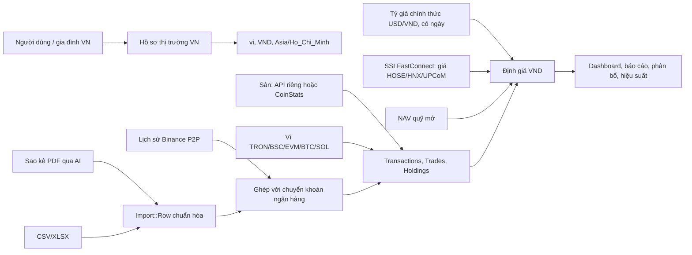

# Kế hoạch triển khai: Quản lý tài chính cá nhân cho Việt Nam, gồm cả tiền số

## Vấn đề

Sure đã có sẵn nhiều nền tảng:
- tài chính theo gia đình, VND, locale tiếng Việt, tài khoản đa tiền tệ;
- kết nối sàn và ví, danh mục nắm giữ, lệnh giao dịch, ví on-chain;
- nhập sao kê PDF bằng AI.

Phần còn thiếu là một trải nghiệm ưu tiên Việt Nam, gồm:
- tiếng Việt đầy đủ;
- tổng tài sản quy về VND theo tỷ giá chính thức, có ghi rõ nguồn, và giá vốn VND đúng với số tiền đã chuyển khi mua USDT qua P2P;
- nhập dữ liệu từ ngân hàng, ví điện tử và công ty chứng khoán mà người Việt đang dùng;
- hỗ trợ các chuỗi và sàn mà người dùng crypto Việt Nam thực sự sử dụng (TRON, BSC, Bybit, OKX, MEXC…);
- định giá cổ phiếu và chứng chỉ quỹ Việt Nam.

## Bối cảnh và định hướng

- **Mô hình triển khai:** SaaS. Giai đoạn đầu chỉ có chủ sở hữu sử dụng, nên ưu tiên các nguồn dữ liệu người đó dùng thật và không cần cơ chế rollout theo nhóm.
- **Nhu cầu thực trước, pháp lý điều chỉnh dần.** Khung pháp lý crypto ở Việt Nam đang thay đổi nhanh (xem [Theo dõi pháp lý](#theo-dõi-pháp-lý)). Tính năng không bị chặn vì luật chưa rõ ràng; sản phẩm sẽ điều chỉnh khi quy định cụ thể hơn.
- **Không bao giờ có quyền ghi.** Chỉ dùng API key read-only và địa chỉ ví công khai. Không yêu cầu, lưu hay truyền seed phrase hoặc private key. Không có thao tác giao dịch hay rút tiền.

## Yêu cầu đã chốt

- Phục vụ cá nhân, gia đình và nhà đầu tư crypto tích cực.
- Giao diện chính là tiếng Việt. Tiền tệ báo cáo là VND; tài khoản vẫn giữ tiền tệ gốc.
- Gộp tài sản từ ngân hàng, ví điện tử, chứng khoán, quỹ mở, sàn tập trung và ví tự quản.
- Nguồn dữ liệu, theo thứ tự ưu tiên:
  - **Ngân hàng và ví điện tử:** Techcombank, Vietcombank, MB Bank, VPBank, ACB, Cake, VIB, HSBC Việt Nam, MoMo, ZaloPay.
  - **Sàn crypto,** xếp theo mức độ phổ biến tại Việt Nam: Binance (đã có) → Bybit → MEXC → OKX → BingX → Bitget → HTX → Gate → KuCoin → Bitfinex.
  - **Ví tự quản:** MetaMask, Trust Wallet, Ledger, gồm cả chuỗi TRON và BSC.
  - **Chứng khoán và quỹ:** TCBS, SSI, VNDirect, DNSE, MBS, Dragon Capital. Giá cổ phiếu cho HOSE, HNX và UPCoM.
- Bao gồm số dư, biến động danh mục, giao dịch, chuyển khoản, phí, phân bổ tài sản và hiệu suất tính theo VND.

## Kết quả nghiên cứu và ràng buộc thiết kế

### Hiện trạng trong repo

- **Tiếng Việt:** `vi` đã là một locale có sẵn và được chọn theo `app/controllers/concerns/localize.rb`. Tuy nhiên mới có **5.722 trên 9.636 key** được dịch (khoảng 59%; 114 file `vi.yml` so với 154 file `en.yml`).
- **Tiền tệ báo cáo:** `Family` dùng một tiền tệ báo cáo, còn tài khoản và lệnh giao dịch giữ tiền tệ gốc.
- **Tỷ giá:**
  - `ExchangeRate::Provided.provider` dùng **một provider FX toàn cục**.
  - Bảng `exchange_rates` không có cột ghi nguồn tỷ giá.
  - Frankfurter v2 (provider mặc định) đã hỗ trợ VND: USD/VND = 25.744 vào ngày 12/11/2026.
- **USDT đang bị ngầm coi là USD.** `Provider::BinancePublic::QUOTE_TO_CURRENCY` map `"USDT" => "USD"`, còn `USD_STABLECOINS` trả về giá tổng hợp 1,0 USD. Với người dùng Việt Nam, cách này làm stablecoin bị định giá thấp hơn thị trường khoảng 1–1,5%.
- **Nhận diện crypto gắn với Binance.** `Security#crypto?` đang so sánh với MIC của Binance (`app/models/security.rb`).
- **Nhập sao kê PDF:** đã có `PdfImport` cùng `Provider::OpenAI::BankStatementExtractor` và `Provider::Anthropic::BankStatementExtractor`.
- **Nhập file khác:** đã có luồng CSV và QIF đi qua `Import::Row`. Định dạng XLSX được nhận diện (`AccountStatement`) nhưng chưa có bộ đọc.
- **Pattern kết nối sàn:** item thuộc gia đình → credential mã hóa → importer → liên kết tài khoản → processor → sync. Các sàn đang có theo pattern này: Binance, Coinbase, Kraken, CoinSpot, CoinStats. Riêng CoinStats đã có `CoinstatsItem::ExchangeLinker` và `Provider::Coinstats#exchange_options` (endpoint `/exchange/support`).
- **Ví on-chain:**
  - Chuỗi hiện có (`Onchain::Chains`): Ethereum, Base, Arbitrum, Optimism, Polygon, Gnosis, Bitcoin, Solana, Cosmos, Polkadot.
  - **Chưa có TRON và BSC**, hai chuỗi người Việt dùng phổ biến cho USDT (TRC-20 và BEP-20).
  - Token mới phát hiện phải được người dùng chọn thủ công, để airdrop rác không tự lọt vào danh mục.
- **Pattern có thể tái dùng:**
  - provider giá theo quốc gia: `Provider::MoexPublic`;
  - NAV quỹ mở: `Provider::Mfapi`;
  - lịch chạy job: `config/schedule.yml`.

### Tỷ giá USDT/VND

Mẫu lấy ngày 12/11/2026 (để so sánh, không phải nguồn định giá mặc định):

| Nguồn | USDT/VND | Ghi chú |
|---|---|---|
| Binance P2P, 10 quảng cáo đầu mỗi chiều | 25.890–26.136 | Endpoint public không chính thức `POST p2p.binance.com/bapi/c2c/v2/friendly/c2c/adv/search` |
| Frankfurter, USD/VND | 25.744 | Tỷ giá chính thức, có lịch sử từ 1998. Đây là nguồn định giá mặc định (USDT ≈ USD) |
| CoinGecko tether/vnd | 25.655 | Chỉ là USD × tỷ giá fiat, không phản ánh thị trường P2P |
| OKX P2P | — | Endpoint public `okx.com/v3/c2c/tradingOrders/books`, có thể dùng làm nguồn phụ |

- Binance P2P là kênh nạp/rút VND chính của người Việt ([Tiger Research](https://reports.tiger-research.com/p/vn-p2p-trading-eng)). Giá P2P thường cao hơn tỷ giá chính thức khoảng 1–2%.
- Binance có endpoint **chính thức** để lấy lịch sử P2P của chính người dùng: `GET /sapi/v1/c2c/orderMatch/listUserOrderHistory` ([tài liệu](https://developers.binance.com/docs/c2c/rest-api/Get-C2C-Trade-History)). Đây là nguồn giá vốn VND chính xác nhất.
- Giá P2P **không có dữ liệu lịch sử công khai**. Chỉ có dữ liệu từ ngày hệ thống bắt đầu chụp giá.
- Không có tỷ giá USDT/VND chính thức, và giá P2P phụ thuộc vào cách tính (giờ, số tiền, phương thức thanh toán, chênh mua–bán 0,5–1%).

**Quyết định: định giá USDT theo USD/VND chính thức.**

| | Lý do |
|---|---|
| Đơn giản | Code hiện đã coi USDT = USD, Frankfurter đã hỗ trợ VND. Không cần migration, job hay endpoint không chính thức |
| Có lịch sử | Biểu đồ tài sản không bị nhảy khoảng 1,2% vào ngày bắt đầu chụp giá P2P |
| Nhất quán | USDT quy đổi giống tài khoản USD và cổ phiếu Mỹ |
| Chênh lệch nhỏ | Khoảng 1–1,5% (số tiền rút được thật cao hơn) nhỏ hơn biến động của crypto và không quyết định hành vi |
| Giá vốn mới là chỗ cần chính xác | Giá vốn lấy từ lịch sử P2P thật (Task 6), nên lãi/lỗ ảo khi mua bán USDT được xử lý đúng |

Xem lại quyết định khi một sàn được cấp phép công bố giá USDT/VND chính thức, hoặc khi chênh lệch P2P vượt khoảng 3% trong thời gian dài.

### Mức độ phổ biến của sàn tại Việt Nam

Độ tin cậy ở mức trung bình, vì không có nguồn nào đo thị phần đầy đủ.

| Sàn | Căn cứ |
|---|---|
| Binance | Sàn phổ biến nhất, kênh P2P VND lớn nhất |
| Bybit | Sàn số 2. Có P2P VND |
| MEXC | Việt Nam là thị trường truy cập số 1 của MEXC (7,5–18% lượt truy cập) |
| OKX | Có P2P bản địa hóa cho Việt Nam. Việt Nam chiếm 5,4–6% lượt truy cập |
| BingX | Việt Nam chiếm khoảng 8% lượt truy cập |
| Bitget, HTX | Được Tiger Research nêu trong nhóm sàn dẫn đầu |
| Gate, KuCoin, Bitfinex | Không có dữ liệu riêng cho Việt Nam |

Nguồn: [Tiger Research 2025](https://reports.tiger-research.com/p/2025-vietnam-web3-market-report-eng), [Flexe](https://flexe.io/blog/exchange-traffic/), [cryip Q1 2026](https://cryip.co/web-traffic-of-cryptocurrency-exchanges-report-q1-2026/), [cryip 5/2026](https://cryip.co/web-traffic-data-of-cryptocurrency-exchanges-may-2026/).

### Nguồn dữ liệu bên ngoài

- **Ngân hàng:** sao kê ngân hàng Việt Nam chủ yếu ở dạng PDF. Nhiều ví điện tử không cho xuất file. Vì vậy nhập PDF bằng AI là con đường chính; CSV/XLSX chỉ làm cho nguồn nào thực sự xuất được file.
- **Chứng khoán:** [SSI FastConnect Data](https://guide.ssi.com.vn/ssi-products/fastconnect-data) là API chính thức. Có giá EOD và realtime, OHLC theo ngày, phủ HOSE, HNX, UPCoM; yêu cầu tài khoản SSI. Thư viện `vnstock` là nguồn scrape không chính thức, không dùng.
- **Bybit:** có API số dư ví unified và transaction log. Lịch sử giới hạn 2 năm ([Wallet Balance](https://bybit-exchange.github.io/docs/v5/account/wallet-balance), [Transaction Log](https://bybit-exchange.github.io/docs/v5/account/transaction-log)).
- **Etherscan v2:** hỗ trợ nhiều chuỗi qua `chainid`, gồm BSC (chainid 56) ([tokentx](https://docs.etherscan.io/api-reference/endpoint/tokentx)).
- **OKX, MEXC và các sàn còn lại:** phải chốt endpoint, thời hạn lưu lịch sử, phạm vi quyền và rate limit trong fixture trước khi viết adapter.

## Giải pháp đề xuất

Thêm một **hồ sơ thị trường Việt Nam** chồng lên kiến trúc đa quốc gia hiện có, thay vì biến hành vi chung thành chỉ dành cho Việt Nam.

## Quy tắc sản phẩm và dữ liệu

- **Định giá VND:**
  - Dữ liệu gốc giữ nguyên. Chỉ quy đổi khi hiển thị/báo cáo, theo tỷ giá có ngày.
  - Thiếu giá hoặc tỷ giá thì hiển thị "chưa xác định", không tự giả định tỷ giá 1:1.
- **Stablecoin:**
  - Các stablecoin neo USD (USDT, USDC…) được định giá bằng USD/VND chính thức, gắn nhãn "tỷ giá chính thức" trên giao diện.
  - Không tự cộng phần chênh lệch P2P vào tổng tài sản.
  - Stablecoin vẫn là tài sản crypto, không phải tiền mặt USD.
  - Giá P2P chỉ là thông tin tham khảo (tùy chọn, làm sau): ví dụ một dòng "nếu bán qua P2P ≈ +1,2%" ở mục stablecoin.
- **Crypto báo giá theo USDT** (BTC/USDT, ETH/USDT…): quy đổi qua USD rồi sang VND bằng cùng tỷ giá chính thức, để BTC và USDT trong danh mục dùng một tỷ giá nhất quán.
- **Lệnh P2P** là chuyển đổi tài sản VND ↔ USDT, không phải chi tiêu hay thu nhập. Giá vốn bằng đơn giá P2P thực tế, nên phần chênh so với tỷ giá chính thức được hiểu là chi phí quy đổi chứ không phải lỗ.
- **Chuyển khoản crypto nội bộ:**
  - Ghép theo thứ tự ưu tiên: tx hash → mã rút/nạp của sàn → (tài sản, số lượng, thời gian, mạng). Nhóm thứ ba chỉ là bằng chứng phụ, cần người dùng duyệt.
  - Chuyển khoản đã xác nhận là nội bộ thì không tạo lãi/lỗ đã thực hiện, cũng không tính là chi tiêu.
- **An toàn khi nhập dữ liệu:**
  - Giữ dòng dữ liệu gốc và mã tham chiếu của nguồn.
  - Nhập lại nhiều lần không tạo bản ghi trùng (idempotent).
  - Dòng nghi trùng hoặc ánh xạ chưa chắc chắn phải hiển thị để duyệt trước khi ghi.
- **Bảo mật:**
  - Credential mã hóa theo quy ước hiện có.
  - Không log secret, token, seed phrase hay private key.
  - Không đưa secret vào fixture hoặc VCR.
- **Phân quyền theo gia đình:** mọi tài khoản, lần nhập, provider item, chẩn đoán và báo cáo đều đi qua `Current.family`, `Current.user` và quyền chia sẻ tài khoản.
- **Phạm vi:** sản phẩm cung cấp sổ sách danh mục và giao dịch, không phải tư vấn pháp lý, thuế hay đầu tư.

## Theo dõi pháp lý

Phần này không chặn tính năng. Mục đích là điều chỉnh sản phẩm khi quy định có hiệu lực thực tế.

| Mốc | Nội dung | Tác động tới sản phẩm |
|---|---|---|
| [Nghị quyết 05/2025/NQ-CP](https://vietnamlawmagazine.vn/government-resolves-to-facilitate-crypto-asset-market-operation-75266.html) (9/9/2025) | Thị trường crypto thí điểm 5 năm. Sàn được cấp phép giao dịch bằng VND. Đã có 5 đơn vị qua vòng 1: TCEX, VIX, CAEX, LPEX, Vietnam Digital Assets | Thêm kết nối sàn được cấp phép khi có API hoặc định dạng sao kê |
| [Nghị định 284/2026/NĐ-CP](https://english.luatvietnam.vn/legal-updates/vietnam-fines-crypto-traders-up-to-usd-1900-for-using-unlicensed-platforms-892-110629-article.html) (1/9/2026) | Phạt nhà đầu tư 30–50 triệu đồng nếu giao dịch trên nền tảng không được cấp phép, áp dụng sau 6 tháng kể từ khi sàn đầu tiên được cấp phép. Phạt tổ chức quảng cáo dịch vụ crypto trái phép | Không quảng bá sàn nước ngoài trong nội dung marketing. Đánh giá lại khi mở cho người dùng khác |
| [Luật Thuế TNCN 109/2025/QH15](https://assets.kpmg.com/content/dam/kpmg/vn/pdf/2026/01/new-pit-law-en.pdf) và [Thông tư 32/2026/TT-BTC](https://gvlawyers.com.vn/wp-content/uploads/2026/03/EN_Legal-alert-_Circular-32-2026_Taxation-of-transactions-in-crypto-assets.pdf) (1/7/2026) | Thuế 0,1% trên giá trị mỗi lần chuyển nhượng qua tổ chức cung cấp dịch vụ tại Việt Nam | Màn hình "ước tính thuế" để tham khảo, sau này |
| [Luật Bảo vệ dữ liệu cá nhân 91/2025/QH15](https://kpmg.com/vn/vi/home/phan-tich-chuyen-sau/2025/06/vietnam-new-personal-data-protection-law.html) và Nghị định 356/2025 (1/1/2026) | Dữ liệu tài chính được bảo vệ chặt. Chuyển dữ liệu ra nước ngoài phải đánh giá tác động. Doanh nghiệp nhỏ được ân hạn 5 năm | Chưa áp dụng khi chỉ có chủ sở hữu dùng. Trước khi mở cho người khác: vị trí máy chủ, cơ chế đồng ý, hồ sơ đánh giá tác động |

## Danh sách task

### Task 0: Khảo sát nguồn dữ liệu thật

- **Mục tiêu:** có mẫu sao kê thật từ mọi nguồn đang dùng trước khi viết bất kỳ parser nào.
- **Cách làm:** tải sao kê từ từng ngân hàng, ví, công ty chứng khoán và quỹ. Với mỗi nguồn, ghi lại:
  - định dạng (PDF/CSV/XLSX/không xuất được);
  - các cột dữ liệu, encoding, định dạng ngày và số;
  - cách ẩn thông tin nhạy cảm để làm fixture.
- **Kết quả:** một bảng năng lực nguồn dữ liệu. Bảng này quyết định nguồn nào đi đường PDF/AI và nguồn nào cần profile CSV/XLSX.

### Task 1: Hồ sơ thị trường Việt Nam với mặc định VND

- **Mục tiêu:** gia đình Việt Nam mặc định dùng `vi`, `Asia/Ho_Chi_Minh`, `DD/MM/YYYY` và báo cáo bằng VND. Gia đình ngoài Việt Nam không bị ảnh hưởng.
- **Hướng triển khai:**
  - Tái dùng các trường locale, currency, timezone, date format của `Family`.
  - Giữ tiền tệ gốc cho mọi tài khoản, holding, entry và trade.
  - Không hard-code VND trong các phép tính báo cáo dùng chung.
- **Test:** mặc định cho Việt Nam, không hồi quy với gia đình ngoài Việt Nam, timezone không hợp lệ, báo cáo VND với tài khoản ngoại tệ.

### Task 2: Hoàn thiện bản dịch tiếng Việt

- **Mục tiêu:** dịch khoảng 3.900 key còn thiếu, theo thứ tự màn hình:
  1. onboarding;
  2. accounts/transactions;
  3. import;
  4. investments/crypto;
  5. budgets/reports;
  6. settings.
- **Hướng triển khai:**
  - Thêm bản dịch cạnh key tiếng Anh, theo cấu trúc locale hiện có.
  - Dùng `t()` cho mọi chuỗi mới.
  - Giữ thuật ngữ nhất quán: "Tài sản", "Nợ phải trả", "Giao dịch", "Giá vốn", "Lãi/lỗ", "Sàn giao dịch", "Ví tự quản", "Đồng bộ", "Tỷ giá P2P", "Tỷ giá chính thức".
- **Test:** không còn key thô trên các màn hình đã dịch; interpolation và pluralization hoạt động đúng.
- **Phát hành:** phần lõi (bước 1–4) nằm trong R1, phần còn lại trong R4.

### Task 3: Hiển thị rõ nguồn tỷ giá stablecoin

- **Mục tiêu:** định giá USDT/USDC theo USD/VND chính thức một cách nhất quán và minh bạch.
- **Hướng triển khai:**
  - Dùng đường quy đổi hiện có (`ExchangeRate::Provided` với provider Frankfurter). Không thêm provider, cột hay job mới.
  - Hiển thị nhãn "tỷ giá chính thức" ở nơi hiển thị giá trị stablecoin.
  - Xác nhận Frankfurter trả USD/VND đầy đủ trong khoảng ngày cần thiết, và thiếu tỷ giá thì hiển thị "chưa xác định".
  - **Tùy chọn, làm sau:** dòng tham khảo giá P2P (`Provider::BinanceP2p`, trung vị top 20 hai chiều) hiển thị riêng, không đưa vào tổng tài sản.
- **Test:** quy đổi USDT/USDC sang VND, thiếu tỷ giá, ngày cuối tuần/lễ, gia đình không dùng VND không đổi hành vi.

### Task 4: Định danh crypto trung lập với provider và quy tắc định giá VND

- **Mục tiêu:** bỏ giả định chỉ có Binance trong cách nhận diện crypto và ghi rõ quy ước stablecoin neo USD.
- **Hướng triển khai:**
  - Gom về một chỗ: phân loại crypto, tách base asset, quy tắc ticker, icon, định danh tài sản chuẩn, các quote currency được hỗ trợ.
  - Định nghĩa đường định giá: giá tài sản (theo USDT) → USD (stablecoin neo USD, `USD_STABLECOINS`) → VND theo tỷ giá chính thức có ngày.
  - Giữ tương thích với security Binance hiện có, vốn có giá lưu bằng `USD` qua `QUOTE_TO_CURRENCY`.
- **Test:** bản ghi Binance hiện có, tài sản từ sàn thứ hai, tài sản on-chain, symbol không an toàn, định giá BTC/ETH/USDT/USDC sang VND, thiếu tỷ giá, stablecoin không nằm trong danh sách neo USD, định giá theo ngày lịch sử.

### Task 5: Thêm chuỗi TRON và BSC

- **Mục tiêu:** hỗ trợ ví USDT TRC-20 và BEP-20, hai mạng người dùng Việt Nam dùng nhiều nhất.
- **Hướng triển khai:**
  - **BSC:** thêm vào danh sách EVM trong `Onchain::Chains` và dùng `Onchain::EvmAdapter` (Etherscan v2 với chainid 56, hoặc explorer tương đương).
  - **TRON:** viết adapter riêng theo hợp đồng adapter hiện có, dùng TronGrid hoặc Tronscan:
    - địa chỉ base58 bắt đầu bằng `T`;
    - số dư TRX native và token TRC-20;
    - lịch sử chuyển khoản.
  - Giữ quy tắc người dùng phải chọn token, để loại token rác.
- **Test:** địa chỉ hợp lệ/không hợp lệ, `ChainDetector` với địa chỉ `0x` trùng nhiều chuỗi, chọn token thủ công, loại token rác, lịch sử bị cắt, API lỗi.

### Task 6: Lịch sử Binance P2P và ghép với chuyển khoản ngân hàng

- **Mục tiêu:** khoản chuyển tiền ngân hàng để mua USDT trên P2P không còn bị tính là chi tiêu; giá vốn USDT bằng đơn giá P2P thực tế.
- **Hướng triển khai:**
  - Mở rộng `Provider::Binance` để nhập lệnh C2C qua `listUserOrderHistory` (chiều BUY và SELL, có phân trang). Lưu số lượng USDT, tổng VND, đơn giá, thời gian, mã lệnh, tên đối tác.
  - Ghép với giao dịch ngân hàng đã nhập theo số tiền VND, khoảng thời gian và tên đối tác/nội dung chuyển khoản. Khi khớp chắc chắn thì tạo Transfer/Trade thay vì chi tiêu.
  - Trường hợp không chắc chắn thì đưa vào danh sách chờ người dùng duyệt.
- **Test:** mua/bán P2P, nhập lặp không trùng, khớp đúng một giao dịch ngân hàng, không khớp, nhiều ứng viên, lệnh bị hủy, phân quyền gia đình.

### Task 7: Chuẩn hóa giao dịch crypto và ghép chuyển khoản nội bộ

- **Mục tiêu:** biểu diễn đúng số dư, lệnh giao dịch, nạp, rút, phí và chuyển khoản cho Binance, Coinbase, Kraken, CoinStats, on-chain và các sàn mới.
- **Hướng triển khai:**
  - Tái dùng raw data của provider account, processor, `Trade`, `Transaction`, `Transfer` và các sync job.
  - Thêm định danh sự kiện ổn định (deterministic) cho từng provider.
  - Ghép theo quy tắc ở phần [Quy tắc sản phẩm và dữ liệu](#quy-tắc-sản-phẩm-và-dữ-liệu).
- **Test:** sync lặp không tạo trùng, cặp nạp/rút, chuyển cross-chain, phí sàn, chuyển một phần, thiếu bên đối ứng, hai gia đình cùng giữ một tài sản, provider lỗi một phần (có ghi `DebugLogEntry`).

### Task 8: Nhập sao kê PDF bằng AI, có kiểm tra cho Việt Nam

- **Mục tiêu:** nhập sao kê ngân hàng Việt Nam qua đường PDF có sẵn. Đây là con đường chính cho Techcombank, Vietcombank, MB, VPBank, ACB, Cake, VIB, HSBC Việt Nam.
- **Hướng triển khai:**
  - Tái dùng `PdfImport` và các `BankStatementExtractor`.
  - Bổ sung gợi ý trích xuất và bước kiểm tra cho sao kê Việt Nam:
    - số dạng `1.234.567`;
    - ngày `DD/MM/YYYY`;
    - phân biệt cột ghi nợ và ghi có;
    - nhận diện ngân hàng phát hành.
  - Kiểm tra số dư đầu kỳ cộng phát sinh phải bằng số dư cuối kỳ. Lệch thì cảnh báo trước khi ghi.
  - Giữ số tham chiếu giao dịch để chống trùng.
- **Test:** fixture PDF đã ẩn thông tin nhạy cảm từ Task 0, sai lệch số dư, dòng nghi trùng, mô tả có dấu tiếng Việt, PDF không đọc được.

### Task 9: Profile CSV/XLSX và bộ đọc XLSX

- **Mục tiêu:** chỉ làm cho những nguồn mà Task 0 xác nhận xuất được CSV/XLSX.
- **Hướng triển khai:**
  - Profile cấu hình sẵn cách ánh xạ cột, delimiter, encoding, định dạng ngày/số và quy ước dấu, rồi đi tiếp qua luồng `Import`, `Import::Mapping`, `Import::Row` hiện có.
  - **Bộ đọc XLSX:**
    - chọn gem được bảo trì tốt và tương thích giấy phép, có lý do rõ ràng theo chính sách dependency;
    - giới hạn kích thước, số sheet, số dòng;
    - không thực thi công thức, macro hay link ngoài.
  - **MoMo/ZaloPay:** nếu không xuất được file thì dùng ảnh chụp màn hình hoặc PDF qua AI.
- **Test:** UTF-8 và dấu tiếng Việt, `DD/MM/YYYY`, `1.234.567`, các biến thể delimiter, dòng lỗi, trùng dòng, cùng dữ liệu cho kết quả giống nhau ở CSV và XLSX.

### Task 10: Bybit qua API riêng

- **Mục tiêu:** sàn mới đầu tiên, phổ biến thứ 2 tại Việt Nam.
- **Hướng triển khai:**
  - Theo pattern `*Item`, provider, importer, chọn tài khoản, processor, sync, mã hóa, chẩn đoán.
  - Kiểm tra key chỉ có quyền đọc trước khi nhập.
  - Map số dư unified, lệnh giao dịch, phí, nạp/rút và transaction ID.
  - Nhập lịch sử P2P nếu API cho phép.
  - Hiển thị rõ giới hạn lịch sử 2 năm.
- **Test:** ký request, parse response, importer, syncer, liên kết tài khoản, idempotent, quyền, rate limit, lịch sử một phần, key bị thu hồi.

### Task 11: OKX qua API riêng

- **Hướng triển khai:** như Task 10. Trước khi viết, chốt endpoint lịch sử tài khoản, thời hạn lưu, phạm vi quyền, rate limit và API lịch sử P2P.
- **Test:** như Task 10.

### Task 12: MEXC qua API riêng

- **Hướng triển khai:** như Task 11.
- **Test:** như Task 10.

### Task 13: BingX, Bitget, HTX, Gate, KuCoin, Bitfinex

- **Mục tiêu:** mở rộng phủ sóng sàn với chi phí bảo trì thấp nhất.
- **Hướng triển khai:**
  - Làm lần lượt theo thứ tự trên.
  - Với mỗi sàn, trước hết kiểm tra `Provider::Coinstats#exchange_options`. Nếu CoinStats hỗ trợ và đủ chi tiết (số dư, lệnh giao dịch, phí, mã nạp/rút) thì đi qua `CoinstatsItem::ExchangeLinker`.
  - Nếu không, viết API riêng theo Task 10.
- **Test:** với mỗi sàn: kiểm tra credential read-only, phân trang, định danh nguồn, phí và chuyển khoản, sync lặp, kết nối bị tắt, cảnh báo dữ liệu thiếu.

### Task 14: Nhập sao kê chứng khoán (TCBS, SSI, VNDirect, DNSE, MBS)

- **Mục tiêu:** nhập dòng tiền, lệnh giao dịch, danh mục, phí và cổ tức từ sao kê công ty chứng khoán.
- **Hướng triển khai:**
  - Map vào `Trade`, `Holding`, `Security`, `Entry` hiện có.
  - Xử lý các sự kiện doanh nghiệp đặc thù Việt Nam, vì chúng làm thay đổi giá vốn:
    - cổ tức bằng tiền;
    - **cổ tức bằng cổ phiếu, cổ phiếu thưởng, quyền mua phát hành thêm**.
  - Với TCBS, xử lý thêm trái phiếu và chứng chỉ quỹ.
  - Giữ tên công ty chứng khoán gốc và mã tham chiếu để đối soát.
- **Test:** mua, bán, bán một phần, phí, thuế bán, cổ tức tiền, cổ tức cổ phiếu, quyền mua, nhiều tài khoản, mã chưa resolve được, phân quyền.

### Task 15: Dữ liệu giá chứng khoán Việt Nam qua SSI FastConnect Data

- **Mục tiêu:** tìm mã, xem metadata, giá hiện tại và giá lịch sử cho HOSE, HNX, UPCoM.
- **Hướng triển khai:**
  - Dùng tài khoản SSI cá nhân, học theo pattern `Provider::MoexPublic`.
  - Hoàn thiện response contract, đăng ký vào registry, cấu hình secure settings, xếp hạng kết quả tìm kiếm, nhập giá lịch sử.
  - MIC: HOSE `XSTC`, HNX `HSTC`, cần xác minh theo ISO 10383. UPCoM do HNX vận hành, cần xác minh có segment MIC riêng hay không.
- **Test:** fixture tìm mã, ánh xạ sàn, parse giá VND, thiếu giá, rate limit, provider lỗi, khoảng trống lịch sử.

### Task 16: Chứng chỉ quỹ mở (Dragon Capital, quỹ của TCBS…)

- **Mục tiêu:** định giá chứng chỉ quỹ theo NAV.
- **Hướng triển khai:**
  - Viết provider NAV theo pattern `Provider::Mfapi`.
  - Nguồn NAV cần khảo sát: website công ty quản lý quỹ hoặc Fmarket.
  - NAV công bố theo kỳ (ngày hoặc tuần), nên giữa hai kỳ dùng NAV gần nhất và hiển thị ngày NAV.
- **Test:** parse NAV, khoảng trống giữa các kỳ, mã quỹ không tồn tại, provider lỗi.

### Task 17: Giao diện danh mục Việt Nam thống nhất

- **Mục tiêu:** một con số tổng tài sản VND gồm tiền mặt, ngân hàng, ví điện tử, sàn, ví tự quản, chứng khoán và quỹ.
- **Hướng triển khai:**
  - Mở rộng dashboard, balance sheet, investment statement, holdings và báo cáo hiện có.
  - Thêm phân bổ theo loại tài sản, token, sàn/ví, chuỗi và **mức độ tiếp xúc stablecoin**.
  - Hiển thị nguồn tỷ giá đang dùng.
  - Hiển thị các trạng thái cần xử lý thay vì bỏ qua im lặng: dữ liệu cũ, thiếu giá, thiếu tỷ giá, cảnh báo nhập, lịch sử bị cắt, chuyển khoản chưa xác nhận, provider lỗi.
  - Dùng component DS và token chức năng.
- **Test:** cộng dồn VND, xem chi tiết theo tiền tệ gốc, quyền xem tài khoản chia sẻ, dữ liệu cũ, giá trị không xác định, giao diện mobile, bản dịch.

### Task 18: Hoàn thiện cho SaaS một người dùng

- **Mục tiêu:** vận hành ổn định cho chủ sở hữu.
- **Hướng triển khai:**
  - Vòng đời credential mã hóa, chẩn đoán sync, trạng thái năng lực của từng nguồn, thông báo giới hạn dữ liệu.
  - Không cần rollout theo nhóm.
  - Ghi danh sách việc cần làm trước khi mở cho người khác: Luật Bảo vệ dữ liệu cá nhân, điều khoản SSI FastConnect, Nghị định 284.
- **Test:** toàn bộ Rails test suite, system test liên quan, Ruby/ERB lint, Biome, Brakeman. Không có secret trong fixture, VCR, log hay báo lỗi. Bản ghi Binance/on-chain hiện có vẫn hoạt động sau khi nâng cấp.

## Thứ tự phát hành

| Bản | Task | Giá trị cho người dùng |
|---|---|---|
| R1: dùng hằng ngày | 0, 1, 2 (phần lõi), 3, 4, 5, 6, 8 | Tổng tài sản VND nhất quán cho crypto (Binance cùng ví TRON/BSC/EVM) và ngân hàng qua PDF. Lệnh P2P không còn bị tính là chi tiêu |
| R2: các sàn chính | 7, 10, 11, 12 | Bybit, OKX, MEXC; ghép chuyển khoản giữa sàn và ví |
| R3: chứng khoán | 14, 15, 16 | Cổ phiếu, quỹ mở, giá HOSE/HNX/UPCoM |
| R4: mở rộng | 9, 13, 17, 18, phần còn lại của 2 | Các sàn còn lại, CSV/XLSX, phân tích danh mục, hoàn thiện |

## Mục mở

- **Giá P2P tham khảo (tùy chọn):** endpoint Binance P2P không chính thức, có thể bị đổi hoặc chặn. Chỉ làm khi cần, và không ảnh hưởng tổng tài sản.
- **SSI FastConnect:** điều khoản về việc lưu và hiển thị dữ liệu khi SaaS mở cho người khác dùng.
- **Lịch sử P2P của Bybit và OKX:** chưa rõ có API hay không.
- **CoinStats:** endpoint `/exchange/support` (kiểm tra ngày 12/11/2026) liệt kê 54 sàn, gồm cả 9 sàn trong kế hoạch: Bybit (`bybit`), OKX (`okex`, cần passphrase), MEXC (`mexcglobal`), BingX (`bingx`), Bitget (`bitget`, cần passphrase), HTX (`huobi`), Gate (`gateionative`), KuCoin (`kucoin`, cần passphrase) và Bitfinex (`bitfinex`). Còn phải kiểm tra mức độ chi tiết thực tế (lệnh giao dịch, phí, mã nạp/rút, lịch sử P2P) bằng một tài khoản sàn có dữ liệu.
- **NAV quỹ mở:** nguồn dữ liệu và tần suất công bố.
- **MIC:** xác minh mã ISO 10383 cho HOSE, HNX, UPCoM.
- **Gem XLSX:** xác nhận có đủ lý do theo chính sách dependency của repo.
